# Model comparison  (runs/prompt = 2, judge = `qwen3.5:9b`)

## 1. Diagrams — real render validation + quality

| Model | block% | raw-valid% | valid-after-sanitize% | avg nodes | emoji% | classDef% | clutter% | avg s | GPU/CPU |
|---|---|---|---|---|---|---|---|---|---|
| `qwen3.5:9b` | 100 | 100 | 100 | 6.2 | 89 | 0 | 0 | 21.8 | 100% GPU |
| `qwen2.5-coder:7b` | 100 | 100 | 100 | 5.9 | 70 | 0 | 0 | 13.3 | 100% GPU |
| `qwen2.5-coder:14b` | 100 | 100 | 100 | 5.8 | 70 | 0 | 0 | 74.4 | 41%/59% CPU/GPU |

## 2. Answer quality — judge 1-5 (overall + by language)

| Model | correct | structure | clarity | complete | overall | EN overall | HI overall | judged% |
|---|---|---|---|---|---|---|---|---|
| `qwen3.5:9b` | 5.0 | 5.0 | 5.0 | 5.0 | 5.00 | 5.00 | 5.00 | 100 |
| `qwen2.5-coder:7b` | 4.6 | 4.9 | 4.9 | 4.1 | 4.61 | 4.88 | 4.25 | 88 |
| `qwen2.5-coder:14b` | 4.9 | 5.0 | 5.0 | 4.6 | 4.88 | 4.94 | 4.81 | 100 |

## 3. Consistency — per-diagram-prompt render pass-rate (valid-after-sanitize)

| Model | office-net | web-arch | boot-flow | vlan-seg | hinglish-net | all-pass% |
|---|---|---|---|---|---|---|
| `qwen3.5:9b` | 2/2 | 2/2 | 2/2 | 2/2 | 2/2 | 100 |
| `qwen2.5-coder:7b` | 2/2 | 2/2 | 2/2 | 2/2 | 2/2 | 100 |
| `qwen2.5-coder:14b` | 2/2 | 2/2 | 2/2 | 2/2 | 2/2 | 100 |

## 4. Structured JSON success rate + latency spread

| Model | options | quiz | suggestions | clarify | struct avg s | diagram min/med/max s |
|---|---|---|---|---|---|---|
| `qwen3.5:9b` | 100% | 100% | 100% | 25% | 21.3 | 12/24/35 |
| `qwen2.5-coder:7b` | 100% | 100% | 100% | 25% | 12.5 | 5/14/27 |
| `qwen2.5-coder:14b` | 100% | 100% | 100% | 25% | 62.4 | 32/72/130 |

## 5. Instruction-adherence on diagrams (higher = follows the rules)

| Model | <=7 nodes% | emoji-on-nodes% | no-classDef% | no-IP-in-node% |
|---|---|---|---|---|
| `qwen3.5:9b` | 90 | 89 | 100 | 100 |
| `qwen2.5-coder:7b` | 90 | 70 | 100 | 100 |
| `qwen2.5-coder:14b` | 100 | 70 | 100 | 100 |

## Diagram samples (first block per prompt — paste into mermaid.live to eyeball)

### `qwen3.5:9b`

**office-net**

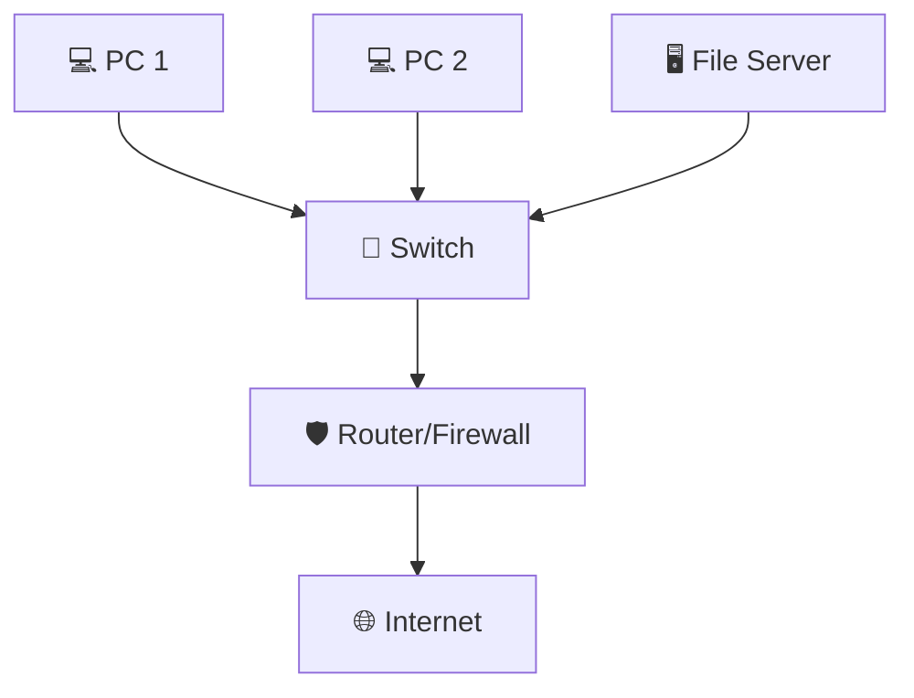

**web-arch**

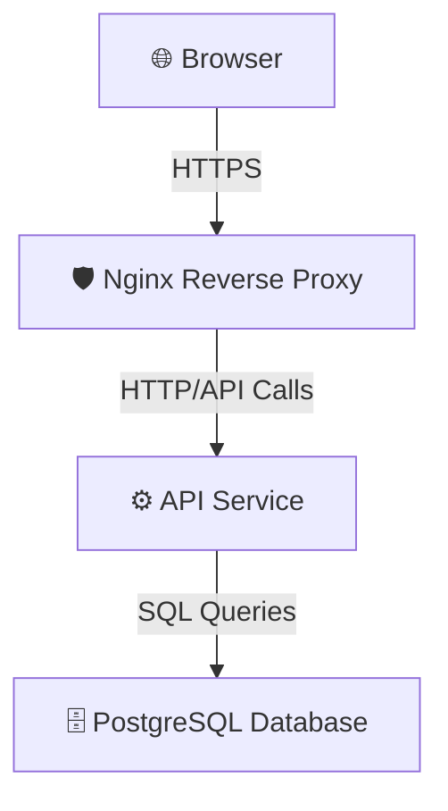

**boot-flow**

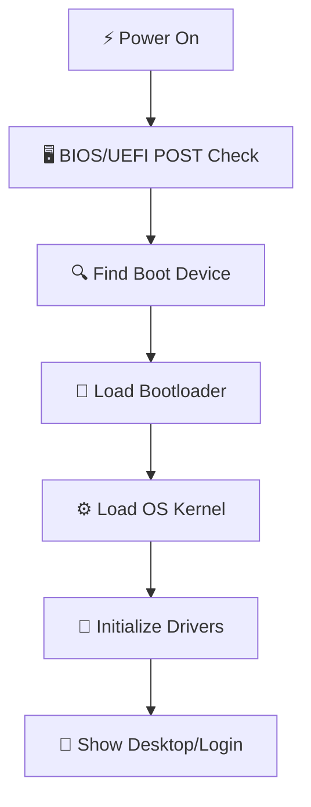

**vlan-seg**

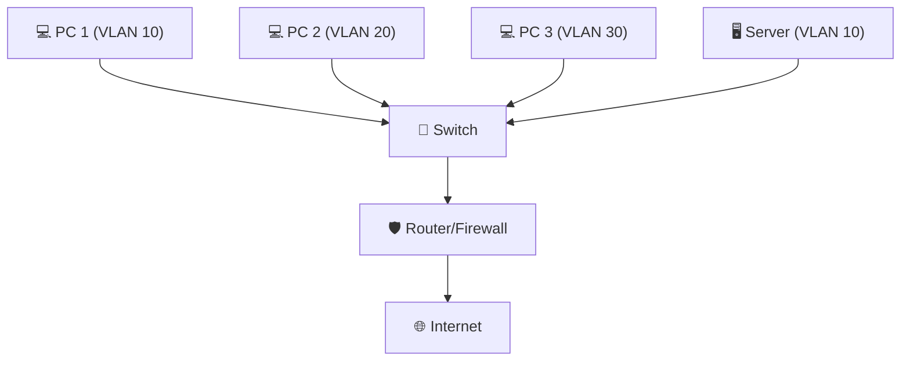

**hinglish-net**

### `qwen2.5-coder:7b`

**office-net**

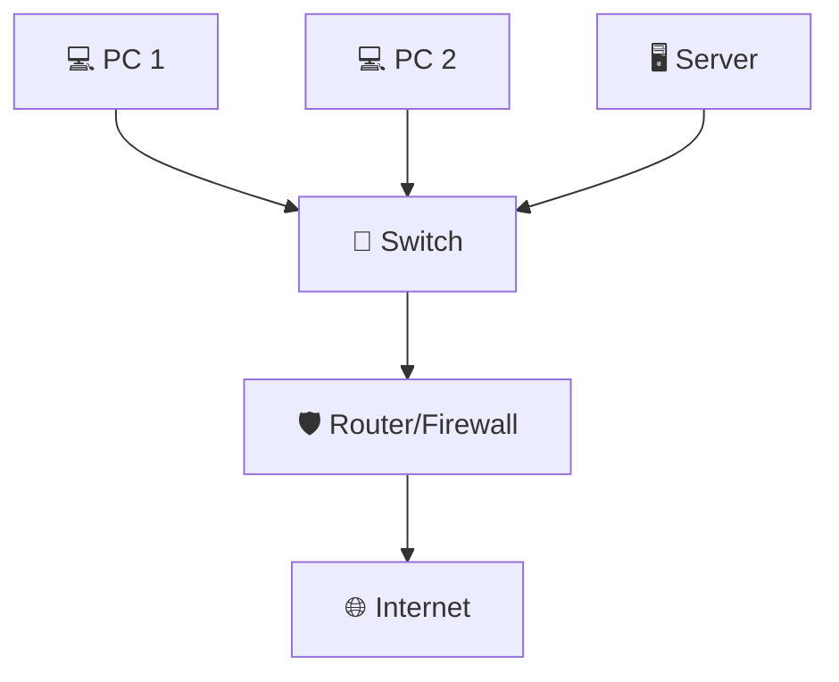

**web-arch**

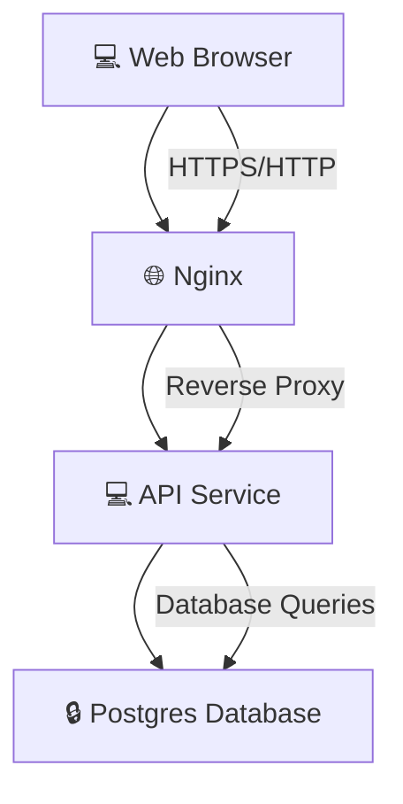

**boot-flow**

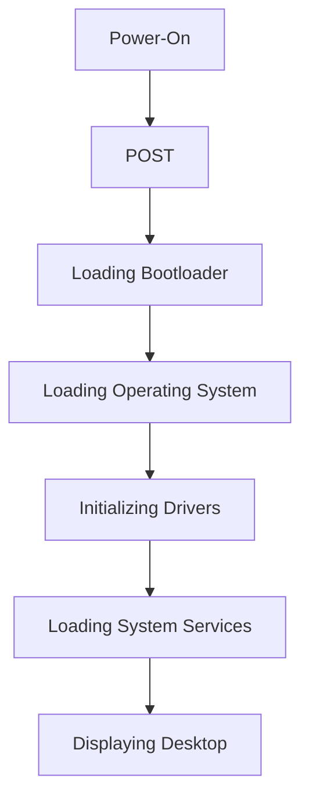

**vlan-seg**

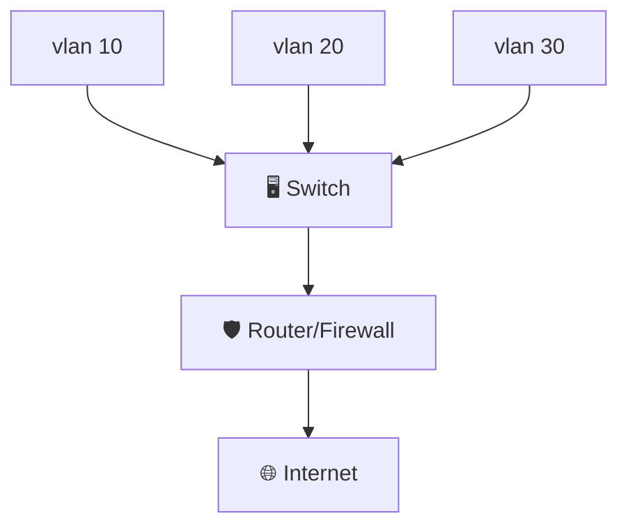

**hinglish-net**

### `qwen2.5-coder:14b`

**office-net**

**web-arch**

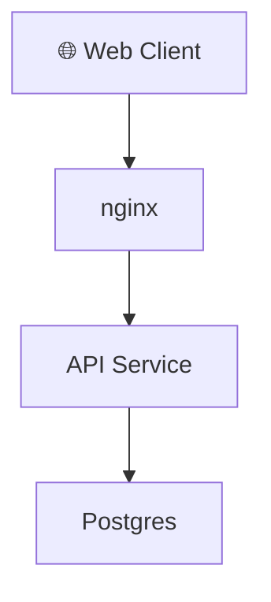

**boot-flow**

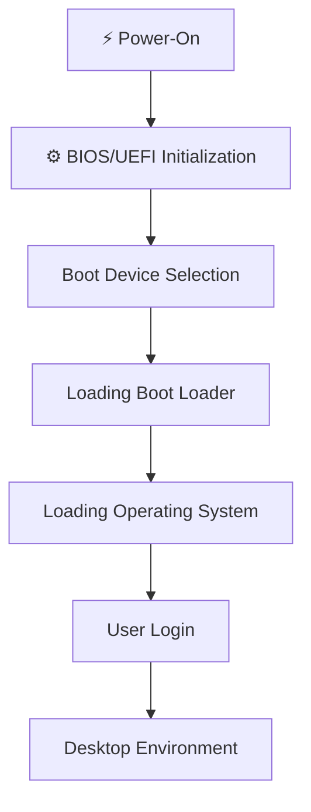

**vlan-seg**

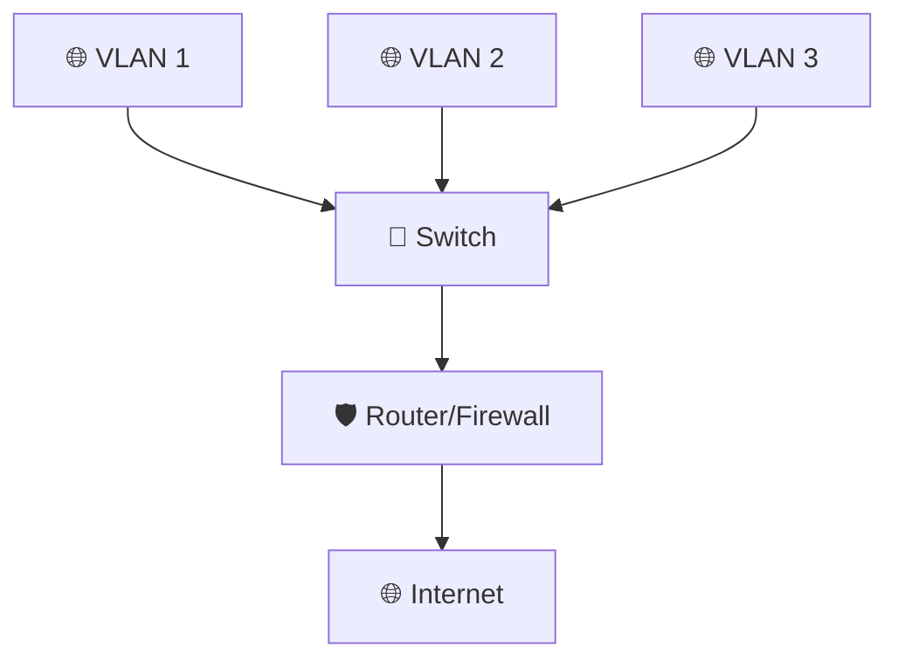

**hinglish-net**

